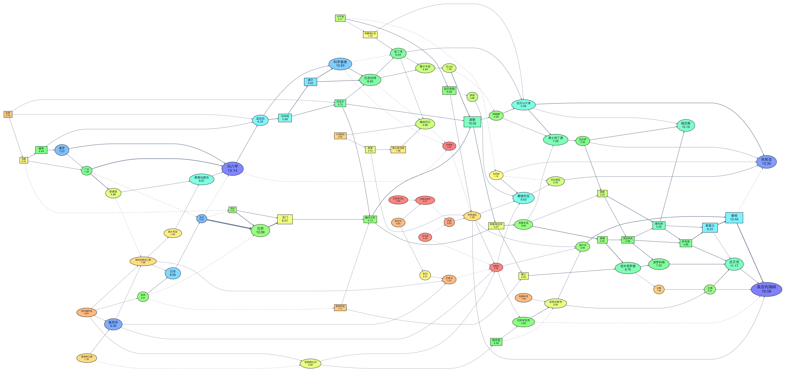

# EU4 贸易网络图

[English](README.md) · [设计说明](docs/architecture.md)

使用 Python、Streamlit 与 Graphviz，将《欧陆风云 IV》的存档贸易数据转为有向网络图，并导出节点、路线数据表。

这个项目解决的是：存档中的贸易节点与流量以嵌套文本保存，不方便直接看出节点之间的关系。应用将这些记录解析成结构化数据，通过节点大小、颜色和箭头宽度展示贸易网络。



## 支持范围

- **仅接受 EU4 1.34.x、无 Mod 的非压缩 `EU4txt` 文本存档。**
- 实际参考样本为 **1.34.4.0**，游戏日期为 1444.12.1；没有验证全部 1.34 补丁版本。
- 其他版本会被明确拒绝，不能据此宣称兼容 1.35 或更新版本。
- 压缩、二进制和铁人存档不在支持范围内。
- 检测到 Mod 元数据或未知贸易节点时拒绝解析。该检查不能证明一个未声明 Mod 的存档从未被修改。
- DLC 与 Mod 分开处理，存档中的 DLC 列表不会导致拒绝。

内置示例从原仓库存档提取，仅保留贸易数据，**不能在游戏中加载**。它完整保留了 80 个节点和 153 条路线的顺序与数值，大小为 13,808 字节。原来的约 51 MB 存档仍可在 `91633ee` 的 Git 历史中找到。

## 安装与运行

需要 Python **3.11+**，以及系统版 Graphviz。

1. 安装 Graphviz：

   - Ubuntu / Debian：`sudo apt-get install graphviz fonts-noto-cjk`
   - macOS：`brew install graphviz`
   - Windows：安装 [Graphviz](https://graphviz.org/download/)，将其 `bin` 目录加入 `PATH`。

   用 `dot -V` 确认安装。中文字体默认使用 Linux 的 Noto Sans CJK SC、macOS 的 PingFang SC 或 Windows 的 Microsoft YaHei，也可以在界面中选择已安装的字体。没有中文字体时可切换为英文节点名。

2. 下载并安装依赖：

   ```bash
   git clone https://github.com/weida-feng/eu4tradegraph.git
   cd eu4tradegraph
   python -m venv .venv
   source .venv/bin/activate
   # Windows PowerShell：.venv\Scripts\Activate.ps1
   python -m pip install -r requirements.txt
   streamlit run app.py
   ```

3. 选择“内置演示”，点击“生成贸易网络图”；也可以选择“上传存档”。在游戏保存界面关闭压缩，使用原版 1.34.x 存档，文件上限为 200 MB。

Streamlit Community Cloud 可使用 `app.py` 作为入口，选择 Python 3.11+；`packages.txt` 包含系统 Graphviz 与中文字体依赖。本仓库没有声明当前存在公开运行的在线演示。

## 如何读图

| 表现 | 含义 |
| --- | --- |
| 节点大小与节点内数字 | 存档中的 `current` 当前节点贸易值 |
| 节点颜色 | `local_value` 本地贸易产出 |
| 箭头宽度 | `incoming.value` 路线贸易流量 |
| 箭头方向 | `incoming.from` 指向包含该记录的节点 |
| 虚线 | 存档记录的零流量路线 |
| 方框 / 椭圆 | 原项目映射中的内陆 / 沿海节点 |

这些数值不等同于某个国家的贸易收入。图形布局表示连接关系，不表示地理距离。大小与线宽采用 min–max 缩放，数据全部相同时使用区间中点，避免除零。

可调整图形宽高比、尺寸、字体和 HSV 颜色范围，下载 PNG、SVG，以及节点和路线的 UTF-8 CSV。CSV 保留原始节点 ID，便于在 pandas 等工具中关联分析。

## 数据处理与验证

代码将界面、解析、绘图和导出分开：

- `parser.py`：识别文本格式、校验版本和节点编号，按区块读取贸易字段。
- `render.py`：计算视觉映射，在内存中生成图片，避免多个会话共用输出文件。
- `export.py`：将节点与路线转换为结构化表格。
- `app.py`：上传、配置图形、查看表格与下载结果。

解析器处理嵌套花括号、引号和注释，不依赖固定缩进；用数值转换代替原代码中的 `eval`。EU4 会省略部分零值字段，解析器将其补为零，且不会误读嵌套国家区块中的同名数值。路线编号从 1 开始，所有节点读取完毕后再检查引用是否有效。

运行检查：

```bash
python -m unittest discover -s tests -v
```

检查覆盖参考样本、版本限制、Mod 与无效输入、零值字段、路线引用、恒定数值绘图、PNG/SVG、CSV 和 Streamlit 演示流程。GitHub Actions 在 Python 3.11 与 3.13 上运行这些检查，并安装系统 Graphviz。

本次整理还使用原始完整存档验证了演示快照：两者解析出的节点和路线数据逐项一致。该结果仅说明参考样本回归通过，不是对其他版本的兼容性承诺。

原项目开发于 2023 年。本次整理保留了原始中文名称和节点分类，补齐运行说明、数据导出与验证记录；项目定位是小型数据可视化应用，不是通用 EU4 存档解析器或贸易策略优化器。
