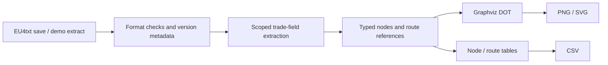

# Data pipeline and design decisions

## Parsing boundary

The reader handles the fields needed by this application. It recognizes braces, quoted strings, escaped characters and comments; skips unrelated nested blocks; and accepts the occasional EU4 block written without an equals sign. It does not reconstruct the full save or interpret the complete Clausewitz language.

Only top-level version/mod/trade fields are used. Inside a trade node, numeric fields are read at that node's scope. This matters because a missing `current` field means zero, while a nested country block can contain a different `current` field. Using a regular expression over the entire node would risk reading the country's value.

EU4's `incoming.from` refers to a one-based position in the saved node list. The app preserves that order, converts references to zero-based indices, and validates them after the full list is available. A reference may point to a node later in the file. Unknown IDs, duplicate nodes, invalid indices and negative/non-finite numeric values raise an input error.

There is no version allowlist. The reference save is 1.34.4.0; other versions may be attempted, but compatibility and results are not guaranteed. The interface warns when the parsed version differs from that reference and still permits rendering and exports. Version metadata must remain well-formed. Declared mods and unknown node IDs are rejected; absent mod metadata is not proof of an unmodified save. The node catalog is intentionally the original project's catalog rather than an inferred newer game's topology.

## Visual mapping

The renderer applies min–max scaling to current value, local value and route flow. Constant ranges use the configured midpoint; zero-flow routes remain visible as dashed arrows. Canonical IDs determine graph connections; translated names only affect labels.

The user-facing aspect ratio is width / height, while Graphviz's `ratio` is height / width. The renderer passes the reciprocal. Graphviz may adjust the final ratio to fit labels and layout constraints.

`graphviz.Digraph.pipe` returns bytes, avoiding shared `graph.png` files. Graphviz remains a required system dependency; font availability affects Chinese rendering. The interface retains only its session's most recent rendered result and associates it with both the parsed snapshot and graph settings, preventing a previous upload's image from being presented as a new result.

## Reference data

`examples/trade_snapshot_1.34.4.eu4` is derived from `original.eu4` at commit `91633ee`. It retains date, version, node order, node trade values and incoming routes. It omits countries, provinces, history and unrelated state, so it is not a playable save. Its parsed representation was compared with the original full save before removing that file from the current tree.

The UTF-8 node catalog is converted from the original GB2312 `trade_center.txt`. Chinese names and inland/coastal flags are retained.

## Validation limits

The test suite covers parsing and indexing failures, unsupported input formats, degenerate numeric ranges, real Graphviz output, CSV content, and the Streamlit demo/source-switch flow. Synthetic version metadata checks that other versions are not blocked and that warnings still allow rendering; it does not verify real saves from those versions. CI runs with Graphviz on Python 3.11 and 3.13. A single campaign extract is not evidence of support across EU4 releases, every 1.34 patch, total-conversion mods or every operating system.

There is no trade-income forecast, optimal-route calculation, geographic map or public deployment in the current scope.
